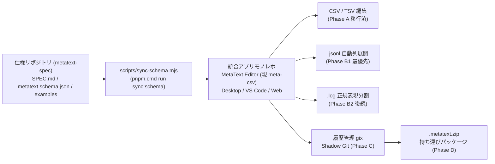

# MetaText 共通仕様 ＆ MetaLog / JSONL 統合計画

> 作成日: 2026-11-26  
> 検討メモ出典: [`docs/note/gemini_talk_20261126-2_log_viewer.txt`](../note/gemini_talk_20261126-2_log_viewer.txt) / [`docs/note/gemini_talk_20261126-3_metatext.txt`](../note/gemini_talk_20261126-3_metatext.txt) / [`docs/note/gemini_talk_20261126-4_jsonl.txt`](../note/gemini_talk_20261126-4_jsonl.txt) / [`docs/note/idea.txt`](../note/idea.txt)  
> 関連計画: [`history-gix-plan.md`](./history-gix-plan.md) / [`packaging-metatext-zip-plan.md`](./packaging-metatext-zip-plan.md) / [`distribution-and-licensing-plan.md`](./distribution-and-licensing-plan.md)

---

## 1. 背景と狙い

MetaCSV の開発を通じて確立したアーキテクチャ（Tauri + Web Worker + Glide Data Grid Canvas 描画 + JSONC サイドカー + `FilterBar` / `Context ±N` / 連続重複折りたたみ / `Facets` / 行マーカー）は、**「巨大なテキストデータを行単位で高速にパースし、擬似テーブルとして表示・調査する」** という点で、構造化ログ（`.jsonl`）やプレーンログ（`.log`）の高速ビューアと心臓部がほぼ同一である。

一般公開後にサイドカー拡張子や JSON Schema の `$id` を変更すると破壊的変更になるため、**統合プロダクト「MetaText Editor」を見据えた共通基盤** として以下を一本化する：

1. サイドカー仕様を **`.metatext.jsonc`**（`<対象ファイル名>.metatext.jsonc`）に統一し、`csv` / `tsv` / `jsonl` / `log` を 1 つの仕様・スキーマで扱う。
2. 仕様・JSON Schema・サンプルは独立した仕様リポジトリ（`metatext-spec`）へ切り出し、アプリ実装の都合に引きずられない中立なフォーマットとして育てる。
3. アプリ・モノレポは分けず、統合アプリ **`MetaText Editor`** として CSV・TSV・JSONL・Log を 1 つの共通基盤でシームレスに扱えるようにする。

---

## 2. `.metatext.jsonc` 共通仕様とリポジトリ構成

### 2.1 リポジトリ分離と同期フロー

- **仕様リポジトリ**: `metatext-spec`（ドキュメント・JSON Schema v0.1・形式別サンプルのみ）
  - 公式 Schema URL 予定: `https://mahorobalab.github.io/metatext-spec/schemas/v0.1/metatext.schema.json`
- **アプリモノレポ**: `meta-csv`（将来 `metatext-editor` / `@metatext/*` への整理を計画）
  - [`scripts/sync-schema.mjs`](../../scripts/sync-schema.mjs)（`pnpm.cmd run sync:schema`）により、`../metatext-spec/schemas/v0.1/metatext.schema.json` を `docs/schema/metatext.schema.json` および `apps/vscode/schemas/metatext.schema.json` へ同期する（仕様リポジトリを Single Source of Truth とする）。

### 2.2 スキーマ階層（共通コア ＋ 形式別セクション）

| レイヤー | 主なプロパティ | 用途 |
| --- | --- | --- |
| **メタ識別・動作モード** | `$schema`, `version`, `format`, `readOnly` | 対象形式（`csv` / `tsv` / `jsonl` / `log` / `text`）と既定の読み取り専用制御 |
| **形式別パーサ設定** | `csv` (`hasHeader`, `delimiter`, `encoding`, `lineEnding`) `jsonl` (`flattenDepth`, `maxAutoColumns`, `arrayMode`, `encoding`) ※Phase B1 で追加予定 `log` (`linePattern`, `columnNames`, `timestampColumn`, `levelColumn`, `multilinePattern`, `wordWrap`, `encoding`) | 対象ファイルの解析ルール・列展開・エンコーディング維持 |
| **共通ビュー・装飾** | `table`, `view` (`sort`, `activeFilter`, `filterContextRows`, `filterPresets`, `markers`), `styles`, `columns`, `rules`, `ranges`, `rows`, `cells` | CSV / TSV / JSONL / Log で 100% 共通利用するレイアウト・検索・ハイライト |
| **ツール間共存領域** | `extensions`, `x-*` | 他アプリや将来の拡張が互いの設定を上書き・削除しないための名前空間 |

> [!NOTE]
> `patchMetaJsonc()` による AST 部分更新を徹底することで、手書きコメントだけでなく未知の `extensions` / `x-*` フィールドも破壊せずに共存させる。

---

## 3. MetaText Editor 拡張設計（Phase B: JSONL 優先 → Log 後続）

### 3.1 共通：Read-Only デフォルト ＋ 明示アンロック

構造化ログ（`.jsonl`）やログファイル（`.log`）は原本保全が最優先となるため、CSV 編集とは別に以下のガードを設ける：

- **初期状態は `readOnly: true`（読み取り専用）**: `.jsonl` / `.log` を開いた際、または `.metatext.jsonc` で `"readOnly": true` が指定されている場合はセル編集・行追加/削除・本体保存をブロックし、ツールバーに `Read-Only` バッジ（錠アイコン）を表示する。
- **サイドカーの操作は制限しない**: 読み取り専用中であっても、列幅調整・`FilterBar` 検索・`Context ±N`・`Facets`・`RowMarker`（調査メモ）・条件付き書式（`rules`）の `.metatext.jsonc` への記録・保存は自由に行える。
- **ロック解除フロー**: 本当にデータを編集・マスクして保存したい場合のみ、錠アイコン（`Unlock Editing`）をクリックして確認後に編集可能へ切り替える。

### 3.2 Phase B1（最優先）: `.jsonl`（JSON Lines）自動列展開

正規表現の作成を手間に感じやすい `.log` よりも先に、**ファイルを開くだけで即座に表になる `.jsonl` を最優先で実装**する：

1. **なぜ `.jsonl` を優先するか**:
   - JSONL 自体には列順・列幅・型定義・表示名が無いため、隣の `.metatext.jsonc` で表示列・順序・非表示・ネスト展開を管理する設計と最も相性が良い。
   - AI 学習データ（プロンプト・回答ペア等）や構造化ログなど、生のままでは横長で読みづらい JSONL を即座に見やすい表にできる。
   - 標準の `JSON.parse()` ベースで確実に列分解でき、既存の `FilterBar` / `Facets` / `RowMarker` / `rules` をそのまま活かせる。
2. **`.jsonl` 特有の要件とメタデータ設計（`jsonl` 設定ブロック）**:
   - **疎なキー（行ごとに異なるキー）への対応**: 1 行目に無く後半の行に突然現れるキーを取りこぼさないよう、全行（または Worker ストリーム）スキャンで列ユニオンを構築する。一方で `.metatext.jsonc` の `columns` で `visible: false` や表示順を固定できるようにする。
   - **ネストと配列の扱い**: `user.name` のようなドット連結フラット化を既定深さ（例: `flattenDepth: 2`）まで自動展開し、それより深い階層や配列（`arrayMode: "json"` 既定）はコンパクトな JSON 文字列としてセルに表示する。
   - **セル編集からの戻し（アンロック保存時）**: フラット化された値から元の JSON オブジェクト構造を再構築または安全にマージして保存する方針を定義する（非 JSON 行が混在する場合はエラー行または生テキスト列にフォールバック）。

### 3.3 Phase B2（後続）: `.log`（行正規表現ベース）パーサ

`.jsonl` の成功パターンを固めたあと、非構造化ログ向けの正規表現パーサを追加する：

1. **正規表現キャプチャ分割 (`log.linePattern`)**: 名前付きキャプチャまたは番号付きキャプチャ＋`log.columnNames` で列分割し、非マッチ行は生テキスト列へフォールバック。
2. **マルチライン連結 (`log.multilinePattern`)**: スタックトレース等の継続行を直前のログエントリに畳み込み。
3. **組み込みプリセット & UI**: ISO8601+Level / Apache / Nginx 等のプリセットと、`linePattern` の試行プレビュー UI を用意。

> [!NOTE]
> `tail -f` 相当のリアルタイム末尾追記追従機能は、Phase B の必須スコープには入れず **後続フェーズ送り** とする。

### 3.4 既存機能の流用マトリクス

| 機能 | 既存基盤の流用可否 | JSONL / Log での役割 |
| --- | --- | --- |
| **Glide Data Grid Canvas** | **100% 流用** | 10 万〜100 万行の 60fps スクロール、等幅フォント表示 |
| **`FilterBar` + 構文検索** | **100% 流用** | `level:ERROR OR level:WARN`、`-healthcheck`、`/regex/` |
| **`Context ±N` (`grep -C`)** | **100% 流用** | エラー行の前後ログを文脈ごと確認 |
| **連続重複折りたたみ (`Collapse`)** | **100% 流用** | 同種リトライ・ポーリング行の圧縮表示 |
| **`Facets`（出現頻度集計）** | **100% 流用** | キーごとの値分布（`level` / `model` / `status` 等）を即座に集計 |
| **`RowMarker`（行マーカー＋メモ）** | **100% 流用** | 調査中の注目行に色付きブックマーク＋原因メモを記録し、`F2` でチーム共有 |
| **条件付き書式 (`rules`)** | **100% 流用** | `ERROR` を赤背景、`WARN` を黄背景に自動ハイライト |
| **データパーサ（Worker 内）** | **新規追加** | PapaParse 分岐に加えて `parseJsonlBytes()`（B1）→ `parseLogBytes()`（B2）を追加 |

---

## 4. プロダクト名称・モノレポ方針

- **プロダクト方向性**: MetaCSV とログ・JSONL 機能を分けず、統合アプリ **`MetaText Editor`** として展開する。
- **モノレポ構成**: 共通パッケージ（現 `@meta-csv/*` → 将来 `@metatext/*`、リポジトリ名も将来的に `metatext-editor` へ整理可能）の中で Desktop / VS Code / Web を一貫して保守する。

---

## 5. 確定方針（オーナー決定済み）

1. **アプリ方針**: 別アプリに分けず、統合アプリ **`MetaText Editor`** として進める。
2. **実装優先順位**: まずは **`.jsonl`（JSON Lines）の自動列展開（Phase B1）** を最優先で実装し、**`.log`（行正規表現ベース、Phase B2）** は後回しとする。
3. **リアルタイム追従（`tail -f`）**: 現フェーズでは実装せず、後回しとする。

---

## 6. ロードマップ（チェックリスト）

### Phase A: `.metatext.jsonc` 仕様統一 ＆ 移行（完了）
- [x] 仕様リポジトリ `metatext-spec` の構築（`schemas/v0.1/metatext.schema.json`, `SPEC.md`, `README*`, CSV/TSV/Log サンプル）
- [x] `scripts/sync-schema.mjs`（`pnpm.cmd run sync:schema`）によるアプリ側スキーマ自動同期
- [x] `@meta-csv/schema` の `MetaTextDocument`（`format`, `readOnly`, `log`, `extensions`, `x-*`）拡張
- [x] Desktop / VS Code / Web / UI / ドキュメント・LP の `.metatext.jsonc` 完全移行と全テスト・ビルド通過

### Phase B1: JSONL 自動列展開 ＆ Read-Only 制御（実装・検証完了）
- [x] `metatext-spec` と `@meta-csv/schema` に `jsonl` 設定ブロック（`flattenDepth`, `arrayMode`, `encoding`, `lineEnding`）と JSONL サンプルを追加・同期
- [x] `packages/core` に `parseJsonlBytes()`（全行キースキャン＋ドット連結フラット化＋非破壊シリアライズ）を実装し単体テストを追加
- [x] `packages/ui` に `Read-Only` デフォルトロック表示／`Unlock Editing` 解除トグルを実装
- [x] Web Worker・Desktop（ファイル選択 `*.jsonl`）・VS Code (`customEditors`)・Web Playground（サンプル JSONL 追加）へ組み込み

### Phase B2: `.log` 正規表現パーサ ＆ CSV スタイル拡充
- [x] `parseLogLines()`（`log.linePattern` / `multilinePattern` / 組み込みプリセット）と設定 UI を実装
- [x] CSV 向け Excel ライクなスタイル操作（文字色・背景色パレット・条件付き書式 GUI）の拡充
- [ ] `MetaText Editor` へのリブランディング・パッケージ名整理の最終適用
